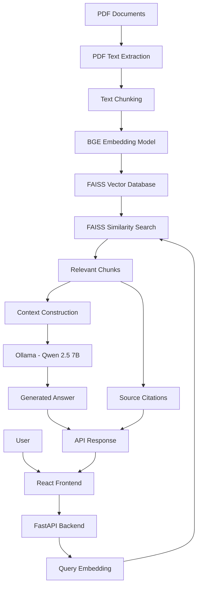

# RAGWise — Local PDF RAG Assistant

<p align="center">
  <strong>Ask questions. Retrieve evidence. Get answers from your PDFs.</strong>
</p>

<p align="center">
  A privacy-focused, locally running Retrieval-Augmented Generation (RAG) application powered by React, FastAPI, FAISS, Sentence Transformers, and Ollama.
</p>

<p align="center">
  
  
  
  
  
  
</p>

---

## Overview

**RAGWise** is a local PDF question-answering application that allows users to upload PDF documents, retrieve relevant information, and generate context-aware answers using a locally hosted Large Language Model (LLM).

Instead of relying only on an LLM's training knowledge, RAGWise retrieves relevant document passages and uses them as context for answer generation.

The application combines a React frontend, FastAPI backend, semantic vector search, and local LLM inference to provide a complete document-based question-answering workflow.

## Key Features

- **PDF Question Answering:** Ask natural-language questions about uploaded PDF documents.
- **Local Embeddings:** Generate document and query embeddings using `BAAI/bge-small-en-v1.5`.
- **Semantic Search:** Retrieve relevant document chunks using FAISS.
- **Document-Aware Retrieval:** Search within a selected PDF or across indexed documents.
- **Local LLM Inference:** Generate answers using Ollama and `qwen2.5:7b`.
- **Source Citations:** Return source filenames, page numbers, and retrieval similarity scores.
- **PDF Upload:** Upload and index PDF documents through the application.
- **REST API:** Access RAG functionality through FastAPI endpoints.
- **Modern Web Interface:** React and Vite frontend integrated with the backend.

## Architecture



## Technology Stack

| Component | Technology |
|---|---|
| Frontend | React, Vite, CSS |
| Backend | Python, FastAPI |
| Embedding Model | BAAI/bge-small-en-v1.5 |
| Vector Database | FAISS |
| LLM Runtime | Ollama |
| Language Model | Qwen 2.5 7B |
| API Communication | REST / JSON |
| Document Processing | PDF extraction and text chunking |

## Project Structure

```text
RAGWise/
│
├── backend/
│   ├── main.py
│   ├── rag.py
│   ├── retriever.py
│   ├── embeddings.py
│   ├── vector_store.py
│   └── ...
│
├── frontend/
│   └── app.py
│
├── frontend-ui/
│   ├── public/
│   ├── src/
│   │   ├── assets/
│   │   ├── services/
│   │   │   └── api.js
│   │   ├── App.jsx
│   │   ├── App.css
│   │   ├── index.css
│   │   └── main.jsx
│   ├── package.json
│   └── vite.config.js
│
├── data/
│   └── pdfs/
│
├── requirements.txt
├── .gitignore
└── README.md
```

*Note: The local PDF folder and generated vector database are runtime data and are not included in the Git repository.*

## Getting Started

### 1. Prerequisites

Install the following:

- Python 3.11
- Node.js and npm
- Git
- Ollama

You can download Ollama from:

https://ollama.com/download

### 2. Clone the Repository

```powershell
git clone https://github.com/AvinashShelukar/RAGWise.git

cd RAGWise
```

### 3. Configure the Python Environment

Create a virtual environment:

```powershell
python -m venv venv
```

Activate it:

```powershell
.\venv\Scripts\Activate.ps1
```

Install Python dependencies:

```powershell
pip install -r requirements.txt
```

### 4. Configure Ollama

Download the Qwen 2.5 7B model:

```powershell
ollama pull qwen2.5:7b
```

Verify that the model is available:

```powershell
ollama list
```

Make sure the Ollama service is running before asking questions.

RAGWise uses Ollama's local generation API, so an external LLM API key is not required.

### 5. Start the FastAPI Backend

From the project root:

```powershell
.\venv\Scripts\Activate.ps1

python -m uvicorn backend.main:app --reload
```

Backend address:

```text
http://127.0.0.1:8000
```

Interactive API documentation:

```text
http://127.0.0.1:8000/docs
```

### 6. Start the React Frontend

Open another PowerShell terminal:

```powershell
cd E:\WCE\RAGWise\frontend-ui
```

Install frontend dependencies:

```powershell
npm install
```

Start the development server:

```powershell
npm run dev
```

Open the local frontend URL printed by Vite, typically:

```text
http://localhost:5173
```

## How to Use RAGWise

1. Start the Ollama service.
2. Start the FastAPI backend.
3. Start the React frontend.
4. Open the RAGWise dashboard.
5. Upload a PDF document.
6. Select the document you want to query.
7. Enter a natural-language question.
8. Receive a generated answer with source citations.

### Example Questions

```text
What is this PDF about?

Summarize this document.

What are the main objectives?

Explain the proposed architecture.

What datasets are discussed in this paper?

What are the key findings?
```

## API Reference

The FastAPI backend exposes the following endpoints:

| Method | Endpoint | Description |
|---|---|---|
| GET | `/` | API status |
| GET | `/health` | Backend health check |
| GET | `/documents` | List available PDFs |
| POST | `/upload` | Upload and index a PDF |
| POST | `/ask` | Ask a question about indexed documents |

### Example: Ask a Question

**Request**

```http
POST /ask
Content-Type: application/json
```

```json
{
  "question": "What is this PDF about?",
  "top_k": 5,
  "source": "example.pdf"
}
```

**Example Response**

```json
{
  "answer": "The document describes the proposed system architecture and its main objectives.",
  "citations": [
    {
      "source": "example.pdf",
      "page": 1,
      "score": 0.82
    }
  ]
}
```

*The response above is illustrative. Actual answers, filenames, and similarity scores depend on the indexed documents and query.*

## Retrieval Pipeline

RAGWise follows a standard Retrieval-Augmented Generation workflow:

1. **Document Ingestion:** Extract text from uploaded PDF documents.
2. **Chunking:** Divide extracted text into smaller passages.
3. **Embedding Generation:** Convert passages into numerical vectors using BGE.
4. **Vector Storage:** Store embeddings and metadata in FAISS.
5. **Query Processing:** Convert the user's question into an embedding.
6. **Similarity Search:** Retrieve relevant chunks from the vector database.
7. **Context Construction:** Prepare retrieved passages for the language model.
8. **Answer Generation:** Use the local Qwen model through Ollama.
9. **Citation Generation:** Return source document and page information.

## Privacy and Local Execution

RAGWise is designed around local processing:

- Embeddings are generated using a locally loaded Sentence Transformers model.
- Vector search runs locally through FAISS.
- Language generation runs through Ollama.
- PDF files and generated vector data are stored locally.

The application does not require a cloud-based LLM API for its normal inference workflow. Model downloads and initial embedding-model downloads do require internet access.

## Current Development Status

| Component | Status |
|---|---|
| PDF ingestion | Implemented |
| Text chunking | Implemented |
| BGE embeddings | Implemented |
| FAISS vector retrieval | Implemented |
| Local Ollama inference | Implemented |
| FastAPI integration | Implemented |
| React + Vite frontend | Implemented |
| PDF selection and upload UI | Implemented |
| Source/page citations | Implemented |
| End-to-end testing | In progress |

## Future Improvements

- Conversation history and contextual follow-up questions.
- Improved retrieval evaluation and ranking.
- Better document preview and citation navigation.
- Support for additional document formats.
- Automated RAG evaluation and benchmarking.
- More comprehensive error handling and monitoring.

## Contributing

Contributions, suggestions, and bug reports are welcome.

1. Fork the repository.
2. Create a feature branch.
3. Implement your changes.
4. Test the application.
5. Submit a pull request with a clear description.

## Author

**Avinash Shelukar**

M.Tech Computer Science and Engineering

Walchand College of Engineering, Sangli

- GitHub: https://github.com/AvinashShelukar
- LinkedIn: https://www.linkedin.com/in/avinash-shelukar-05b01b246/

## License

This project is licensed under the MIT License, subject to the repository's actual license file.

---

<p align="center">
  <strong>RAGWise — Your documents. Your knowledge. Your local AI.</strong>
</p>